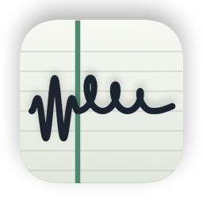
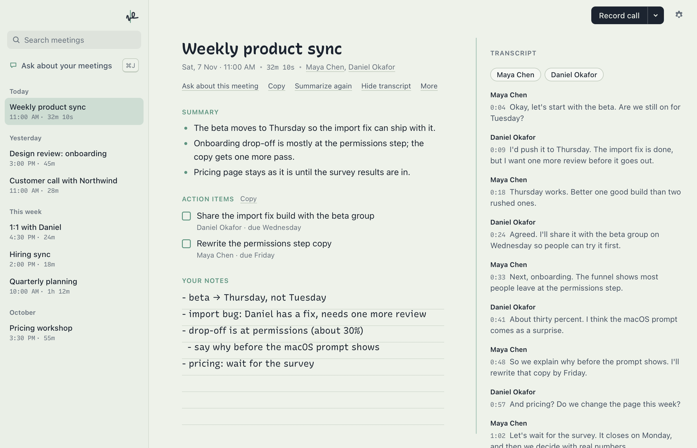
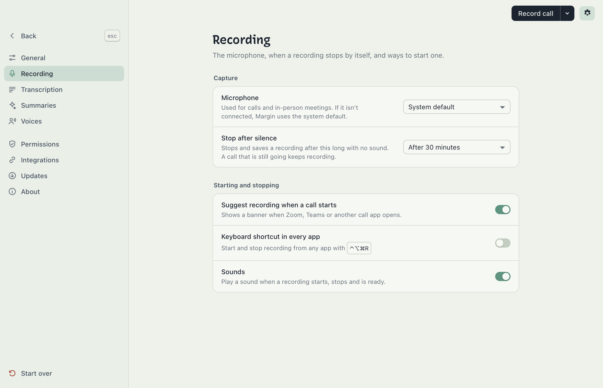

<p align="center">
  <picture>
    <source media="(prefers-color-scheme: dark)" srcset="docs/images/app-icon-dark.png">
    
  </picture>
</p>

<h1 align="center">Margin</h1>

<p align="center">A calm meeting notepad for macOS. You write the notes, and Margin records, transcribes and saves each meeting as Markdown on your Mac.</p>

<p align="center">
  <a href="https://github.com/askysh/margin/releases/latest"></a>
  <a href="https://github.com/askysh/margin/actions/workflows/ci.yml"></a>
  
  <a href="LICENSE"></a>
</p>

<p align="center">
  <picture>
    <source media="(prefers-color-scheme: dark)" srcset="docs/images/screenshot-dark.png">
    
  </picture>
</p>

## Why Margin

- **The notepad comes first.** You type notes in your own words while Margin records the
  call. The live transcript stays beside your notes, not in their place.
- **Everything runs on your Mac.** Transcription, speaker separation and voice recognition
  are local. Summaries and Ask are optional, and off until you choose an engine.
- **Your meetings are plain Markdown.** Each meeting is a `.md` file with YAML frontmatter
  in a folder you choose. Obsidian, iCloud Drive and any text editor can read it.
- **It is built on [minutes-core](https://github.com/silverstein/minutes)** (MIT).
  minutes-core supplies the whisper transcription, pyannote diarization, voice recognition
  and Markdown output. Margin adds a new interface, a short setup and a working **Reset**.

## Install

```bash
brew install --cask askysh/tap/margin
```

Or download the DMG from the
[latest release](https://github.com/askysh/margin/releases/latest). The app is signed with
a Developer ID and notarized by Apple.

Margin needs an Apple Silicon Mac with macOS 14.4 or later. It updates itself: it
downloads a new version in the background and installs it when you restart or quit
Margin, never during a recording. Settings → Updates turns the automatic check off.

## What it does

- **Setup in five steps.** Each step has a default, so Return alone finishes setup:
  1. Your name.
  2. The meetings folder (`~/Documents/Meetings`, an Obsidian vault or any folder) and
     the model (Fast, Balanced or Best). The model download continues in the background.
  3. The Microphone and System Audio permissions, each with a one-line reason.
  4. Optional summaries.
  5. The three ways to start a recording.
- **Recording.** *Record call* (⌘⇧R) records your microphone and the call audio. *Record
  in person* (⌘⇧I) records the microphone only.
  - The notepad opens with a live transcript beside it. In calls, live lines are marked
    You / Them.
  - Make the window narrow to keep it beside the call. The sidebar becomes a drawer
    (⌘\ hides it in a wide window), and a switch picks Notes or Transcript.
  - With Fast or Balanced, Margin transcribes the meeting in 2-minute pieces while it
    records. After *Stop*, only the last piece or two is left. Settings → Transcription →
    "Transcribe during the meeting" turns this off.
  - After *Stop*, the meeting opens as soon as its transcript is ready. Speaker names and
    the summary fill in when they are done. Your notes stay editable the whole time.
  - Closing the window keeps Margin in the menu bar. Quitting during a recording saves
    the meeting first.
- **The meeting.** Edit your notes and the title. Margin saves the notes into the file's
  `## Notes` section and keeps the frontmatter and other sections byte for byte. The file
  name does not change, so Obsidian links keep working.
  - **Copy** puts the summary, your notes, the transcript or the whole meeting on the
    clipboard as Markdown.
  - **Action items** show as a checklist with owner and due date.
  - **Summarize again** replaces the summary and keeps your notes.
  - **Play** the recording, or click a time in the transcript to play from there.
- **Speaker names.** Click a speaker, type a name and choose *Rename everywhere*. Margin
  updates the transcript, the summary, action items, `attendees` and `speaker_map`.
  With "Recognise this voice" on, the next meeting labels that person by voice.
- **Library and search.** Meetings are grouped by Today, Yesterday, This week and month.
  Search covers titles, notes and transcripts. Click an attendee to list only the meetings
  with that person.
- **Ask.** Click the bar at the bottom or press ⌘J to ask Claude about one meeting or all
  of them. Ask uses your own `claude` CLI and can only read the meetings folder. Answers
  link to the meetings they used. Each meeting keeps its own conversation.
- **Menu bar.** The menu bar shows the elapsed time of a recording and the five newest
  meetings. An optional global shortcut, ⌃⌥⌘R, starts and stops a recording from any
  app. A banner offers to record when a call app such as Zoom starts.
- **Settings.** A page in the main window, opened with ⌘, the gear or the menu bar. A
  list of sections is on the left, and *Back* (or Esc) returns to where you were:
  - **General:** your name, the meetings folder, how long to keep audio, open at login.
  - **Recording:** the microphone, stop after silence, call suggestions, the global
    shortcut and sounds.
  - **Transcription:** the model, transcribing during the meeting, the meeting language,
    speaker separation, and names and words to spell right.
  - **Summaries**, **Voices**, **Permissions**, **Integrations** (an MCP snippet, so
    Claude can read your meetings), **Updates** and **About**.
- **Reset.** *Reset Margin…* under *Start over* clears settings, the processing queue,
  logs and state, then runs setup again.
  - "Keep my meetings", "Keep downloaded speech models" and "Keep recognised voices" are
    on by default.
  - To delete meetings you must type `delete`. Margin moves only the files it recognises
    as meetings to the Trash, so a vault keeps its other notes.
  - Audio that was not processed goes to `failed-captures/` and is never deleted.
- **Crash safety.** Notes typed during a recording are saved as you type. If Margin stops
  unexpectedly, the next launch shows them and resumes unfinished processing.

<p align="center">
  <picture>
    <source media="(prefers-color-scheme: dark)" srcset="docs/images/settings-dark.png">
    
  </picture>
</p>

## Where your data lives

| What | Where |
|---|---|
| Meetings (`.md` and `.wav`) | the folder you chose, default `~/Documents/Meetings` |
| Settings (minutes-core config) | `~/Library/Application Support/Margin/config.toml` |
| Models, jobs, logs, state | `~/Library/Application Support/Margin/state/` |
| Ask conversations | `~/Library/Application Support/Margin/state/chat/` |
| Logs | `~/Library/Application Support/Margin/state/logs/margin.log` and `margin-worker.log` |
| Voice profiles (shared) | `~/.minutes/voices.db` |

Margin does not read or write the upstream Minutes app's `~/.config/minutes` or
`~/.minutes`, except `voices.db`.

## Privacy

Audio, transcripts and notes stay on your Mac unless you turn on one of these:

- **Summaries.** The default is None. With **Claude**, Margin sends the transcript and
  your notes to your own `claude` CLI. With **Ollama**, it sends them to Ollama on your
  Mac.
- **Ask.** Ask runs your own `claude` CLI. Claude gets the Read, Grep and Glob tools for
  the meetings folder only. It cannot write files or run commands.

Margin also connects to the internet for two things. It downloads the speech and speaker
models from Hugging Face and GitHub. It checks GitHub for a new version of Margin, which
you can turn off in Settings → Updates. Margin has no account and sends no analytics.

## Known limits

- **The live You / Them labels are an estimate.** Margin compares the loudness of your
  microphone and the call audio for each line. Real speaker names come after processing.
  In-person meetings show no live labels.
- **Call recordings are labelled by source first.** minutes-core labels lines
  `MICROPHONE` (you) and `SYSTEM` (the call). Margin shows them as You / Them, and you can
  rename them. All voices on the call side share one label unless diarization separates
  them.
- **Diarization quality is minutes-core's.** On synthetic test voices it found 3 speakers
  for 2.
- **Ollama models that think first, such as qwen3, time out.** minutes-core gives a
  summary 2 minutes and does not turn thinking off
  ([UPSTREAM-PATCHES.md](UPSTREAM-PATCHES.md) #3). Use a model without thinking (llama3.2,
  gemma3) or Claude. Margin's error message says this.
- **The System Audio permission check uses private macOS calls.** minutes-core has no
  check for this permission, so Margin loads `TCCAccessPreflight` and `TCCAccessRequest`,
  as Apple's AudioCap sample does. If Apple changes them, Margin shows "Open System
  Settings" in place of "Allow".
- **Voices are shared with the upstream Minutes app.** minutes-core always uses
  `~/.minutes/voices.db` ([UPSTREAM-PATCHES.md](UPSTREAM-PATCHES.md) #1).
- **Not yet in Margin:**
  - Meeting titles and attendees from your calendar (off by design,
    [DECISIONS.md](DECISIONS.md) D9).
  - Reloading when another app changes a meeting file. The meeting view reloads when the
    window comes to the front.
  - Live partial transcripts. You see finished lines only, a few seconds behind.

## Development

Margin is Tauri v2 with a React UI in `src/` and Rust in `src-tauri/`.
[docs/development.md](docs/development.md) says how to build, run and test it, and how to
move to a new minutes-core. [docs/README.md](docs/README.md) is a map of the other docs.
Product and technical decisions are in [DECISIONS.md](DECISIONS.md).

## Contributing

Issues and pull requests are welcome. Read [CONTRIBUTING.md](CONTRIBUTING.md) first. For a
bug, attach `margin.log` from `~/Library/Application Support/Margin/state/logs/`.

## Security

Report a vulnerability privately through
[GitHub security advisories](https://github.com/askysh/margin/security/advisories/new).
[SECURITY.md](SECURITY.md) says what counts.

## License

MIT, see [LICENSE](LICENSE). minutes-core is MIT licensed by its authors.
